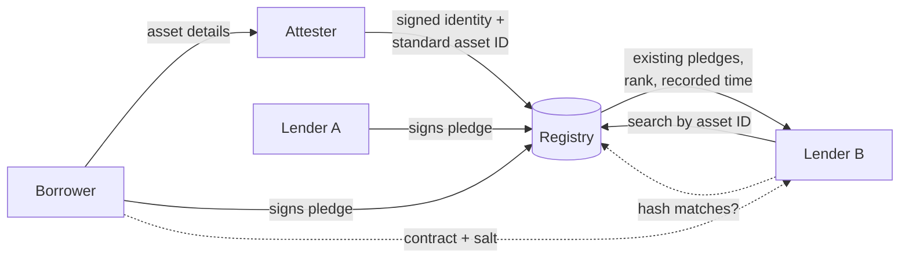

# Concept

## The problem

A business pledges an asset to secure a loan. Another lender is later asked to lend against the same asset. Today that lender has no reliable way to know:

- whether the asset is already pledged,
- to whom, and in what order,
- how much of its value is already spoken for.

The US UCC filing system was not built to answer those questions:

| Lenders need | UCC-1 filings today |
|---|---|
| Lookup by **asset** | Lookup by **debtor name** only, across 50 separate state databases |
| Which specific asset is pledged | Filings often say "all assets" |
| Amount and ranking of each pledge | Not recorded |
| Instant, current results | Hours to weeks of lag depending on the state |
| Proof the borrower agreed | Anyone can file; debtor authorization is required but never checked |

Double-pledging, where the same collateral is given to more than one lender, was alleged in the 2025 First Brands and Tricolor collapses.

## The idea

A shared **collateral registry**, organized by asset, where:

1. An independent **attester** verifies an asset exists and gives it a **standard asset ID**.
2. Every **pledge** names that asset ID, is signed by both borrower and lender, and records its priority and a maximum secured amount.
3. The pledge contract stays private. Only its **salted hash** is recorded.
4. Any admitted lender can **search by asset ID** and see every active pledge, not just the ones the borrower chose to disclose.
5. When shown a contract, a lender can **hash it** and confirm it matches what was recorded.
6. All history is **append-only and hash-chained**, so it can't be quietly rewritten.

## Why each piece is needed

| Piece | What breaks without it |
|---|---|
| **Attester** | Nobody confirms the asset is real. Fake invoices and phantom equipment get pledged. |
| **Standard asset ID / fingerprint** | The borrower describes the same asset differently each time and every pledge looks like a new asset. |
| **Search by asset** | A contract hash only proves the document you were shown is genuine. It can't reveal the pledges the borrower hid. |
| **Two-party signatures** | Bogus filings, as happens with UCC-1s today. |
| **Salted contract hash** | Either contracts are public (unacceptable to lenders) or nobody can check a copy against the record. |
| **Hash-chained ledger** | The operator, or anyone who compromises it, could backdate or delete a pledge and change who ranks first. |

## What the registry does and doesn't guarantee

**Guarantees**

- Every pledge recorded against an asset ID is visible to admitted lenders, in priority order.
- A contract shown to you matches, or doesn't match, what was recorded.
- The record of who pledged what, and when, hasn't been altered since it was written.
- Both borrower and lender agreed to each pledge.

**Doesn't guarantee**

- That an attester told the truth. Accreditation, bonds and liability handle that, not cryptography.
- That pledges made outside the registry don't exist. It only works if lenders agree to check it, or the law requires it.
- What the asset is worth today. Valuations go stale. "Headroom" is a hint.
- Legal priority. Until state law recognizes the registry, lenders still file a UCC-1. Each pledge record links to its filing.

## Is a blockchain required?

No. The design works as a **central database run by a neutral operator**, with a hash-chained log. Two upgrades add trust where it's needed:

1. **Anchoring.** Periodically publish a hash of recent events to a public blockchain (the `anchor` table). Anyone can then prove the operator didn't rewrite history, and no registry data goes on-chain.
2. **A shared ledger.** If the participating lenders won't accept any single operator, the same event log can be replicated across a permissioned ledger that they jointly run.

Start with option 1. Move to option 2 only if participants insist on it. Several bank consortium blockchains (we.trade, Marco Polo, Contour) shut down in 2022–2023 because members never fully committed. The hard part is getting lenders to participate, not the technology.

## Where to start

Begin with **one asset class that has good unique IDs**:

| Asset class | Unique ID | Natural attester |
|---|---|---|
| Equipment | Manufacturer + serial number | Dealer, manufacturer, inspector |
| Vehicles | VIN | State title records |
| Receivables | Seller + customer + invoice number + amount + date | **The customer who owes the money** |
| Warehouse inventory | Warehouse + receipt number | Warehouse operator |

Fungible inventory and general business assets are a poor fit, because nothing identifies one unit apart from another.
