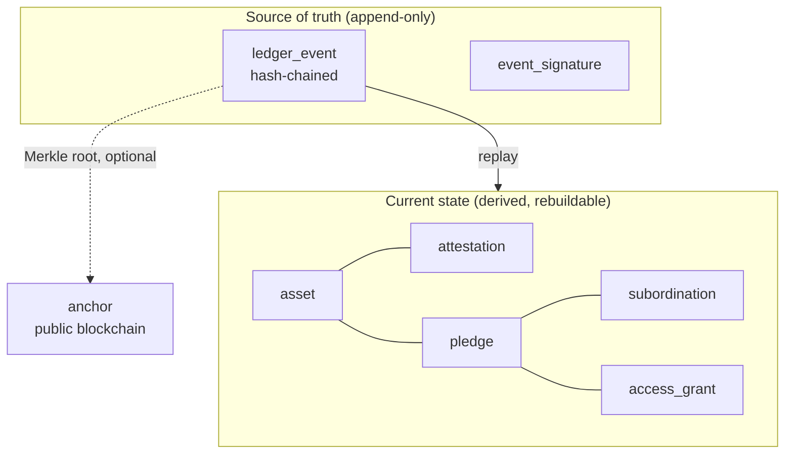
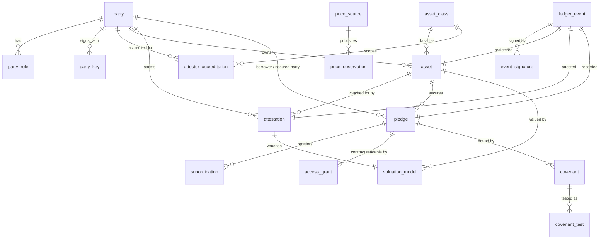
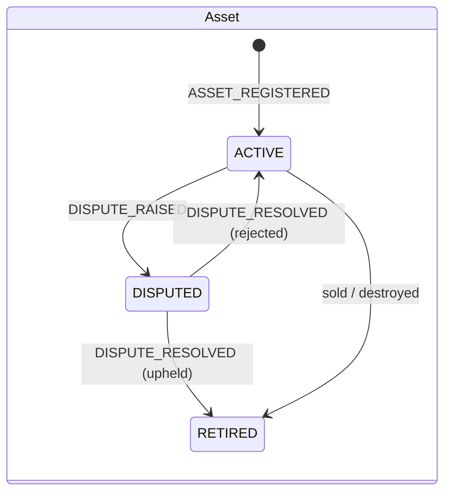
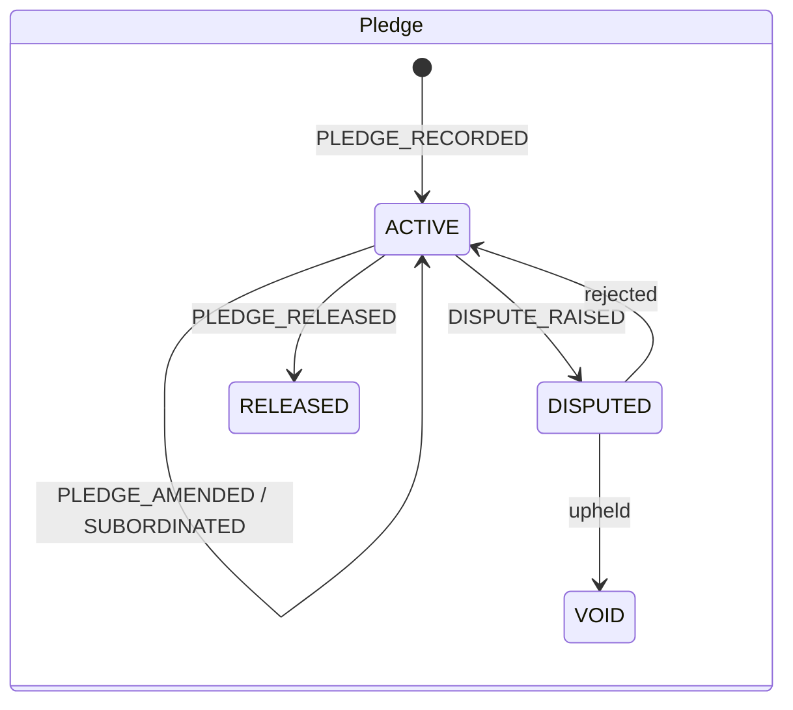

# Data model

The full DDL is in [`schema/registry.sql`](../schema/registry.sql) (SQLite dialect, portable to Postgres).

## Two layers

- **The ledger** records every change as a signed event. Each event's hash includes the previous event's hash, so changing any past event breaks every hash after it. Database triggers block updates and deletes.
- **The state tables** hold the current picture for fast lookup. Each row points back to the ledger event that created it (`*_seq` columns). If the state tables are ever lost or disputed, replay the ledger to rebuild them.

## Entity relationships

## Entities

### Participants

| Table | Purpose | Key fields |
|---|---|---|
| `party` | Any legal entity on the registry | `registration_id` (LEI / EIN), `jurisdiction`, `status` |
| `party_role` | BORROWER, LENDER, ATTESTER, OPERATOR. One party can hold several. | `granted_at`, `revoked_at` |
| `party_key` | Public signing keys, kept separate so they can be rotated | `algorithm`, `public_key`, `revoked_at`, **`compromised_since`** |
| `attester_accreditation` | Which attesters may vouch for which asset classes, backed by what bond | `asset_class`, `attestation_type`, `bond_minor` |

`compromised_since` matters. If an attester's key is stolen, every signature made after that time can be flagged automatically without touching history.

### Assets

| Table | Purpose | Key fields |
|---|---|---|
| `asset_class` | Defines what makes an asset unique and what attestation it needs | `identity_fields`, `required_attestation` |
| `asset` | One real-world asset, with its standard ID | `asset_id`, **`fingerprint`**, `owner_party_id`, `status` |
| `attestation` | A third party's signed statement about an asset | `attestation_type`, `statement_hash`, `valuation_minor`, `expires_at` |

**How the fingerprint works**

1. Take the fields listed in `asset_class.identity_fields` (for example `manufacturer` + `serial_number`).
2. Normalize them: uppercase, strip spaces and punctuation. `"CAT0320-GXK-01234"` and `"cat 0320 gxk 01234"` become the same value.
3. Compute a **keyed hash** (HMAC) using a secret held by the registry operator.
4. `UNIQUE(asset_class, fingerprint)` makes a second registration of the same asset fail, however it's described.

The hash is keyed rather than plain because identity fields are guessable. Invoice numbers are sequential and amounts are round. With a plain hash, anyone could hash likely values and find out which invoices are pledged.

**Attestation types**

| Type | Meaning | Typical attester |
|---|---|---|
| `EXISTENCE` | The asset exists at a stated place and time | Warehouse operator, inspector |
| `IDENTITY` | This asset matches these identifying details | Dealer, manufacturer |
| `OWNERSHIP` | The borrower owns it | Title office, seller |
| `OBLIGOR_CONFIRMATION` | The customer confirms it owes this invoice | The customer |
| `VALUATION` | Value as of a date and method | Appraiser |

### Pledges

| Table | Purpose | Key fields |
|---|---|---|
| `pledge` | A security interest in one asset | `max_secured_minor`, **`contract_hash`**, `recorded_seq`, `priority_rank`, `ucc_state` + `ucc_file_number` |
| `subordination` | An earlier lender agreeing to rank behind a later one | `senior_pledge_id`, `junior_pledge_id` |
| `access_grant` | Who may read the full contract | `grantee_party_id`, `expires_at` |
| `dispute` | A challenge to an asset, attestation or pledge | `subject_type`, `status`, `resolution` |

**Priority.** By default, the order in which pledges were recorded in the ledger (`recorded_seq`) decides who ranks first. A `subordination` event signed by the lender giving up its place reorders the ranking. `priority_rank` is derived from those two things and never set directly.

**Contract hash.** `contract_hash = sha256(salt || contract_bytes)`. The salt is a random value kept with the contract, outside the registry. Without the salt, nobody can confirm a guess about a contract's contents by hashing standard templates. With the contract and its salt, any lender can check that a copy is genuine.

**Caps, not balances.** `max_secured_minor` is the most a pledge can claim. Live loan balances aren't recorded, because lenders won't publish them and they change daily.

### Valuation and covenants

See [05-valuation.md](05-valuation.md) for the methods and the covenant math.

| Table | Purpose | Key fields |
|---|---|---|
| `valuation_model` | How an asset's value is worked out; one current model per asset | `method` (APPRAISAL, STRAIGHT_LINE, DECLINING_BALANCE, MARKET_PRICE), `params`, `attestation_id` |
| `price_source` | A feed that publishes signed prices | `operator_party_id`, `max_staleness_seconds` |
| `price_observation` | One signed price | `instrument_id`, `price_minor`, `observed_at` |
| `covenant` | A loan term on a pledge, signed by both parties | `kind` (MIN_COVERAGE, MAX_LTV), `threshold_bp`, `haircut_bp` |
| `covenant_test` | Cached test results, reproducible from the inputs | `ratio_bp`, `breach_value_minor`, `result`, `exposure_basis` |

The schema also adds a `SECURITY_HOLDING` asset class for shares held directly on an issuer's or transfer agent's books, identified by issuer, share class, holder and position.

### Ledger

| Table | Purpose |
|---|---|
| `ledger_event` | Every change: `seq`, `event_type`, `subject_id`, canonical JSON `payload`, `payload_hash`, `prev_hash`, `event_hash` |
| `event_signature` | One row per party that had to agree to the event, signing its `payload_hash` |
| `anchor` | Optional: a Merkle root over a range of events, published to a public chain |

`event_hash = sha256(seq | prev_hash | payload_hash | recorded_at)`

**Who must sign which events**

| Event | Required signers |
|---|---|
| `ASSET_REGISTERED` | Owner |
| `ATTESTED` / `ATTESTATION_REVOKED` | Attester |
| `PLEDGE_RECORDED` / `PLEDGE_AMENDED` | Borrower **and** secured party |
| `SUBORDINATED` | The lender giving up its place (and the borrower) |
| `PLEDGE_RELEASED` | Secured party |
| `VALUATION_MODEL_SET` | Accredited valuation attester |
| `PRICE_RECORDED` | Price source |
| `COVENANT_SET` | Borrower **and** secured party |
| `ACCESS_GRANTED` | Borrower or secured party |
| `DISPUTE_RAISED` | Any admitted party |
| `DISPUTE_RESOLVED` | Operator (after the agreed dispute process) |

## Lifecycles

Nothing is ever deleted. "Released" and "void" are new events, and the original pledge stays in the history.

## Who sees what

| Data | Public | Admitted lenders | Granted parties |
|---|---|---|---|
| Asset exists, class, status | ✓ | ✓ | ✓ |
| Active pledges: rank, secured party, recorded time, UCC-1 reference | ✓ | ✓ | ✓ |
| Attestation summary (type, attester, date) | ✓ | ✓ | ✓ |
| Pledge caps, latest valuation, indicative headroom | | ✓ | ✓ |
| Valuation model and price history | | ✓ | ✓ |
| Covenant terms and test results | | | Borrower and that lender |
| Full contract | | | ✓ |

These tiers match the two views in the schema: `public_pledge` and `lender_asset_position`. Showing the secured party's name publicly mirrors UCC-1 practice and lets a prospective lender contact the existing lender. Whether caps should be public too is an open question (see [04-risks-and-open-questions.md](04-risks-and-open-questions.md)).
