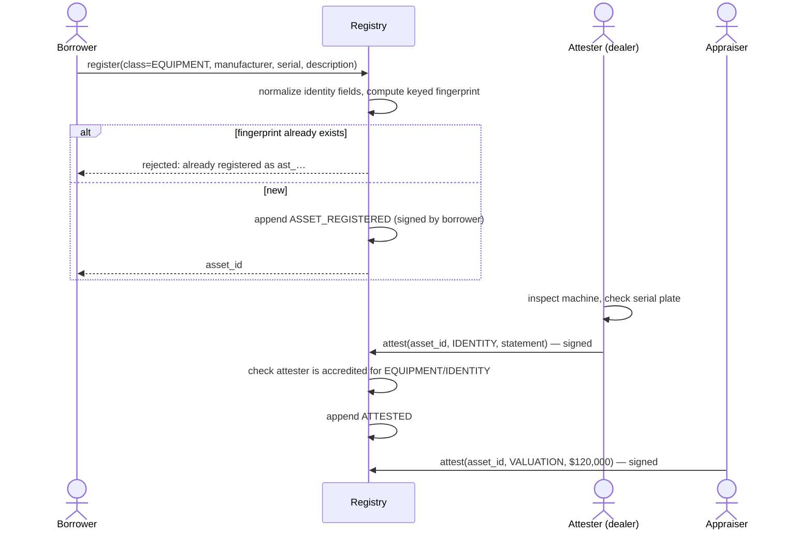
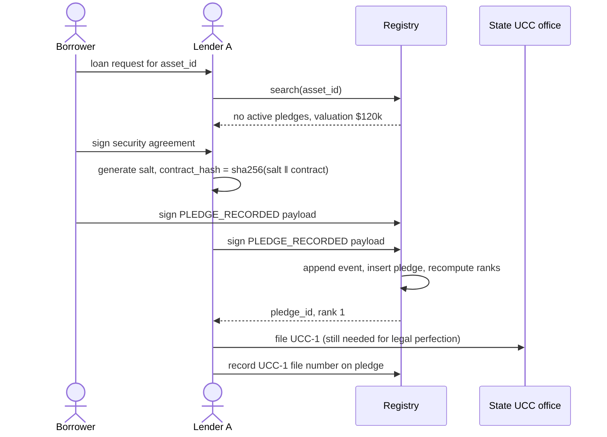
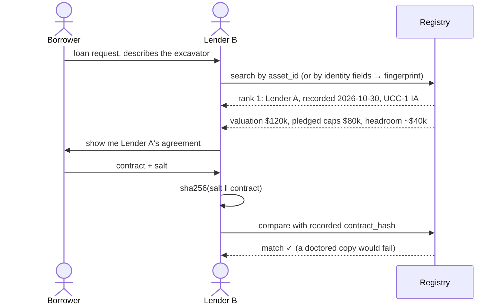
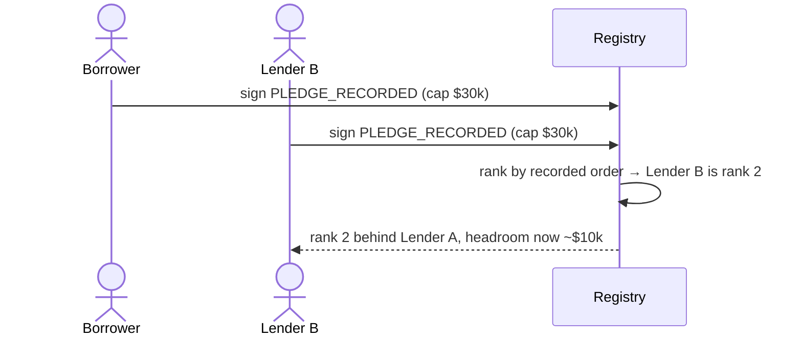
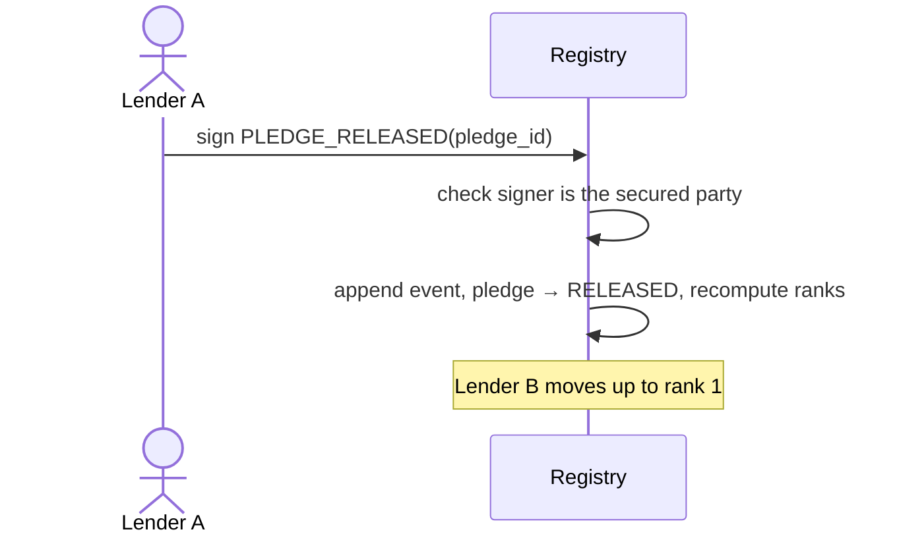
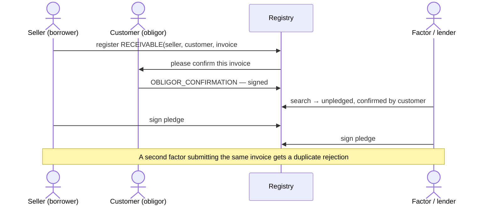
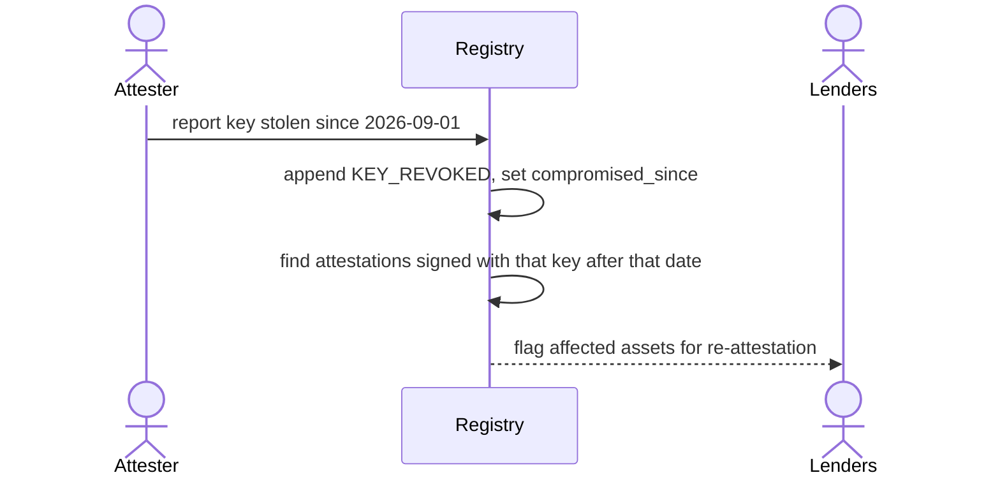

# Workflows

Each workflow below matches a step in [`examples/demo.py`](../examples/demo.py).

## 1. Register and attest an asset

An asset can't be pledged until its class's required attestation exists (`asset_class.required_attestation`).

## 2. Record a pledge

The registry needs both signatures before it accepts a pledge. That alone stops bogus filings.

## 3. A second lender checks before lending

This is the step the registry exists for.

The search must be by asset, not by the contract the borrower hands over. A borrower who hides a pledge simply won't show that contract. Searching by asset ID returns every pledge anyway.

If the borrower gives a new description instead of the asset ID, Lender B can submit the identity fields (manufacturer + serial). The registry computes the fingerprint and finds the existing record.

## 4. Second-position pledge

To jump ahead of Lender A, Lender B would need Lender A to sign a `SUBORDINATED` event.

## 5. Release

The released pledge stays in the history. Only its status changes.

## 6. Receivables variant

For invoices, the attester is the **customer who owes the money**. That's the only party that can confirm the invoice is real.

This blocks the two classic factoring frauds: **fake invoices** (the customer won't confirm) and **the same invoice sold twice** (duplicate fingerprint).

## 7. Compromised attester key

Nothing is rewritten. The affected attestations are flagged, and lenders decide whether to require a new one.
