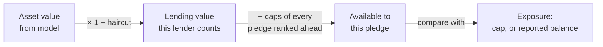

# Valuation and covenant monitoring

Knowing an asset is pledged isn't enough. Lenders also need to know whether it is **still worth enough** to cover the loans against it. The registry provides a valuation engine that works the same way for any asset class, plus covenant tests that run against it.

Run [`examples/valuation_demo.py`](../examples/valuation_demo.py) to see both in action.

## Two rules the design follows

**1. Value is a fact about the asset. Risk terms belong to each loan.**

| Belongs to the asset (attested once) | Belongs to each loan (signed by borrower + lender) |
|---|---|
| Depreciation schedule | Haircut: how much of the value the lender counts |
| Price feed and quantity | Covenant type and threshold |
| Appraisal and how long it's valid | Warning margin |

Two lenders against the same excavator see the same value but may apply different haircuts and thresholds.

**2. Inputs are on the ledger. Results are computed.**

Valuation models, price observations and covenants are signed ledger events. Valuations and covenant results are worked out from them on demand and can be reproduced exactly for any past or future date. The `covenant_test` table is a cache: delete it and every row can be regenerated.

## Valuation methods

| Method | Use for | Parameters | Value at date *t* |
|---|---|---|---|
| `APPRAISAL` | Anything with a one-off professional valuation | value, as-of date, valid days | The appraised value. **STALE** once past its valid period. |
| `STRAIGHT_LINE` | Equipment, vehicles | basis value, basis date, useful life, salvage | basis − (basis − salvage) × min(1, years ÷ life) |
| `DECLINING_BALANCE` | Assets that lose value fastest early (vehicles, tech) | basis, basis date, annual rate, salvage | max(salvage, basis × (1 − rate)^years) |
| `MARKET_PRICE` | Securities, commodities, fund units (with NAV) | instrument, quantity, price source | quantity × latest price at or before *t*. **STALE** if the price is older than the source allows. |

The attester who sets the model is accredited for `VALUATION` on that asset class, and their statement is hashed into a `VALUATION` attestation. Setting a new model (for example after a re-appraisal) supersedes the old one. The old one stays in the history.

**Price sources** are parties with the `PRICE_SOURCE` role: an exchange, a market-data vendor, or a fund administrator publishing NAV. Each price is a signed `PRICE_RECORDED` event, with the market time it was observed kept separately from the time it was recorded.

## Covenant tests

Two covenant types cover most loan agreements. They're the same test expressed two ways:

| Type | Passes when | Example |
|---|---|---|
| `MIN_COVERAGE` | available value ÷ exposure ≥ threshold | "Collateral must cover the loan 1.25 times" |
| `MAX_LTV` | exposure ÷ available value ≤ threshold | "Loan-to-value may not exceed 50%" |

### What "available value" means

- **Haircut** — the share of value the lender ignores, for volatility, forced-sale discounts or transfer restrictions. Each lender sets its own.
- **Senior claims** — every pledge ranked ahead counts at its **full cap**. A junior lender can't see senior balances, and a revolving senior loan can be drawn back up to its cap at any time. This is deliberately cautious.
- **Exposure** — the pledge's cap by default. A lender can **report its actual outstanding balance** for its own test. The reported balance stays out of the ledger and is visible only to that lender and the borrower.

### Results

| Result | Meaning |
|---|---|
| `PASS` | Within threshold, outside the warning margin |
| `WARN` | Within the warning margin (default: within 10% of the threshold) |
| `BREACH` | Threshold crossed |
| `STALE` | The value depends on an expired appraisal or an out-of-date price. The last ratio is still shown, but it isn't treated as a pass. |
| `NO_MODEL` / `NO_PRICE` | Nothing to value the asset with |

`STALE` takes priority over `PASS`. A registry that says "fine" because the price feed went quiet is worse than no registry.

Each result also reports:

- **Breach value** — the asset value at which the covenant fails exactly. For a market-priced holding, divide it by the quantity to get a **trigger price per unit**.
- **Projected breach date** — for depreciation schedules, the month the scheduled value crosses the breach value.

## Worked examples (from the demo)

### Excavator, two lenders

$120,000 basis, straight-line over 7 years to $20,000. First Bank (rank 1, $80k cap, minimum 1.25x). River Credit (rank 2, $30k cap, minimum 1.00x).

| Date | Value | First Bank | River Credit |
|---|---|---|---|
| Oct 2026 | $119,922 | 1.50x PASS | 1.33x PASS |
| Oct 2027 | $105,646 | 1.32x WARN | 0.85x **BREACH** |
| Oct 2028 | $91,331 | 1.14x **BREACH** | 0.38x **BREACH** |

- The **junior lender absorbs the loss first**. River breaches a year before First Bank, which is exactly why second-position loans cost more.
- Projected breach dates: River around **July 2027**, First Bank around **March 2028**. Both lenders know this the day they lend.
- If First Bank reports its amortized balance of $50,000 in 2028, it passes at 1.83x. River still counts First Bank at the $80,000 cap and stays in breach.

### Restricted shares, market price

100,000 shares. Harbor Bank lends up to $1,000,000, maximum 50% LTV, 30% haircut.

| Date | Price | Value | LTV | Result |
|---|---|---|---|---|
| Nov 2 | $40.00 | $4,000,000 | 35.7% | PASS |
| Nov 3 | $30.00 | $3,000,000 | 47.6% | WARN |
| Nov 4 | $25.00 | $2,500,000 | 57.1% | **BREACH** |
| Nov 9 | (no new price) | $2,500,000 | 57.1% | **STALE** |

Trigger price: **$28.57 per share** ($1,000,000 ÷ 50% ÷ 70% ÷ 100,000).

## What the registry does not do

- **Decide what happens after a breach.** Margin calls, cure periods and enforcement come from the loan agreement and the lender. The registry gives both parties the same agreed numbers. A natural next step is a signed `COVENANT_BREACH_NOTICE` event so the notice date is provable.
- **Guarantee the value.** A depreciation schedule is an estimate. A machine run hard loses value faster than the schedule says. Re-appraisal (a new model) is the fix, and lenders can require one periodically.
- **Price illiquid assets.** For private company shares there's no market price. Use `APPRAISAL` with a short validity period, or the latest funding round price as an appraisal input.
- **Protect against a bad price feed.** A wrong or manipulated price produces wrong results. See the mitigations in [04-risks-and-open-questions.md](04-risks-and-open-questions.md).

## Possible extensions

- **Receivables aging** — value an invoice at face amount minus a haircut that grows as it goes past due, and drop it to zero once the customer disputes it.
- **Multiple price sources** — take the median of several feeds so one bad price can't trigger a false breach.
- **Pools** — test a covenant against a basket of assets (for example all receivables pledged under one facility) instead of one asset at a time.
- **Scheduled tests** — run every covenant daily and notify the borrower and lender on WARN or BREACH.
