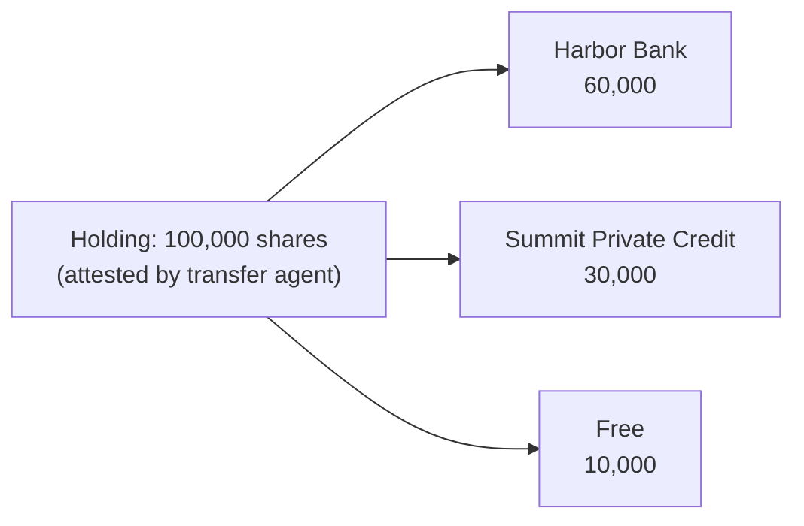

# Partial pledges by quantity

Some assets are a **quantity of interchangeable units**: shares, bond face amount, bushels of grain in a warehouse, fund units. A holder can pledge part of the holding to one lender, part to another, and keep the rest free. The registry tracks how many units are pledged to whom and won't let the total go above what the holder actually has.

Run [`examples/valuation_demo.py`](../examples/valuation_demo.py) (Part B) to see it in action.

## Which assets are divisible

Each asset class has a `divisible` flag. For divisible classes, the class's required attestation carries the **quantity held**, and every pledge must state a **quantity**.

| Asset class | Divisible | Quantity attested by |
|---|---|---|
| `SECURITY_HOLDING` | Yes | Transfer agent or issuer (`OWNERSHIP`) |
| `WAREHOUSE_LOT` | Yes | Warehouse operator (`EXISTENCE`) |
| `EQUIPMENT`, `VEHICLE`, `RECEIVABLE` | No, pledged whole | — |

## Blocks, not layers

Each pledge takes **its own block of units** from the free balance.



Why not let a second lender take a junior claim on the same shares, as with the excavator?

- **Shares are interchangeable.** There's no way to say which particular shares are second lien.
- **Real share pledges work by exclusive control.** The lender controls a stated number of shares through a control agreement with the transfer agent or broker. Two lenders can't both control the same shares.
- **It keeps the math simple.** Each block is first in line on its own units. Nobody ranks ahead of it, so covenant tests don't need the senior/junior waterfall.

The core rule:

> **Units pledged across all active pledges ≤ units attested as held.**

The registry enforces it whenever a pledge is recorded or topped up, and checks it whenever a new holding quantity is attested.

## Operations

| Operation | Signed by | Effect | Ledger event |
|---|---|---|---|
| **Pledge** a quantity | Borrower + lender | Takes units from the free balance. Rejected if not enough are free. | `PLEDGE_RECORDED` |
| **Top up** a pledge | Borrower + lender | Moves more free units into an existing block, e.g. to cure a margin call | `PLEDGE_AMENDED` |
| **Partial release** | Lender | Returns some units to the free balance, usually with a lower cap after a paydown | `PLEDGE_RELEASED` (with `units_released`) |
| **Full release** | Lender | Returns all units; the pledge closes | `PLEDGE_RELEASED` |
| **Stock split / consolidation** | Transfer agent | Scales the holding **and every active pledge** by the same ratio | `QUANTITY_ADJUSTED` |
| **New holding quantity** | Transfer agent | If it's below the pledged total, the asset is frozen and a dispute opened | `ATTESTED`, then `DISPUTE_RAISED` |

**Splits round down.** In a 3-for-2 split, 1,001 shares become 1,501 (not 1,501.5). The issuer settles the fraction in cash, as it would off the registry.

**Overpledging is reported, not rejected.** If the transfer agent reports 150,000 shares held while 180,000 are pledged, that's a fact the registry can't refuse. It marks the asset `DISPUTED`, opens a dispute, and blocks new pledges until the parties sort it out. This is how the registry catches a borrower who sold pledged shares outside it.

## Covenant tests on blocks

Each block is valued on its own units:

```
block value      = asset value × block units ÷ total units held
lending value    = block value × (1 − haircut)
LTV              = exposure ÷ lending value
trigger price    = breach value ÷ block units
```

Because each block is first in line on its own units, there are no senior claims to subtract. Two lenders on the same holding can use different haircuts and thresholds and get independent results.

## Worked example (from the demo)

Northwind Holdings holds **100,000** restricted shares.

| Lender | Shares | Cap | Covenant | Haircut | Trigger price |
|---|---|---|---|---|---|
| Harbor Bank | 60,000 | $600,000 | max 50% LTV | 30% | **$28.57** |
| Summit Private Credit | 30,000 | $250,000 | max 50% LTV | 35% | **$25.64** |

A third lender asks for 20,000 shares and is **rejected**: only 10,000 are free.

**As the price falls:**

| Price | Harbor | Summit |
|---|---|---|
| $40.00 | 35.7% PASS | 32.1% PASS |
| $30.00 | 47.6% WARN | 42.7% PASS |
| $25.00 | 57.1% **BREACH** | 51.3% **BREACH** |

**Then:**

1. **2-for-1 split.** The holding becomes 200,000 shares, Harbor's block 120,000, Summit's 60,000. The post-split price of $12.60 equals $25.20 before. Both lenders are still in breach, and nothing had to be re-entered.
2. **Top-up.** Northwind moves its 20,000 free shares into Harbor's block (140,000). Harbor improves from 56.7% BREACH to 48.6% WARN.
3. **Partial release.** Northwind repays $150,000 to Summit. Summit releases 20,000 shares and lowers its cap to $100,000. Summit goes from 50.9% BREACH to 30.5% PASS. 20,000 shares are free again.
4. **Overpledge caught.** The transfer agent reports Northwind now holds 150,000 shares while 180,000 are pledged. The asset is frozen and a dispute opened.

## Limits and extensions

- **Divisible assets don't support layered claims.** A lender wanting a junior claim on someone else's block isn't modelled. It could be added as a pledge on a pledge (a sub-block with its own rank), but that's rare in practice for securities.
- **Corporate actions beyond splits.** Mergers, spin-offs and conversions change *what* is held, not just how many. They'd need the transfer agent to re-attest the holding and the parties to re-sign the pledges.
- **Bonds.** Use face amount as the quantity (for example, units of $1,000 face value). Price feeds quote bonds per 100 of face value, so the valuation model would need a scale factor.
- **Warehouse lots.** The same model works for grain or metals under a warehouse receipt. The warehouse operator attests the quantity, and price feeds come from commodity exchanges.
